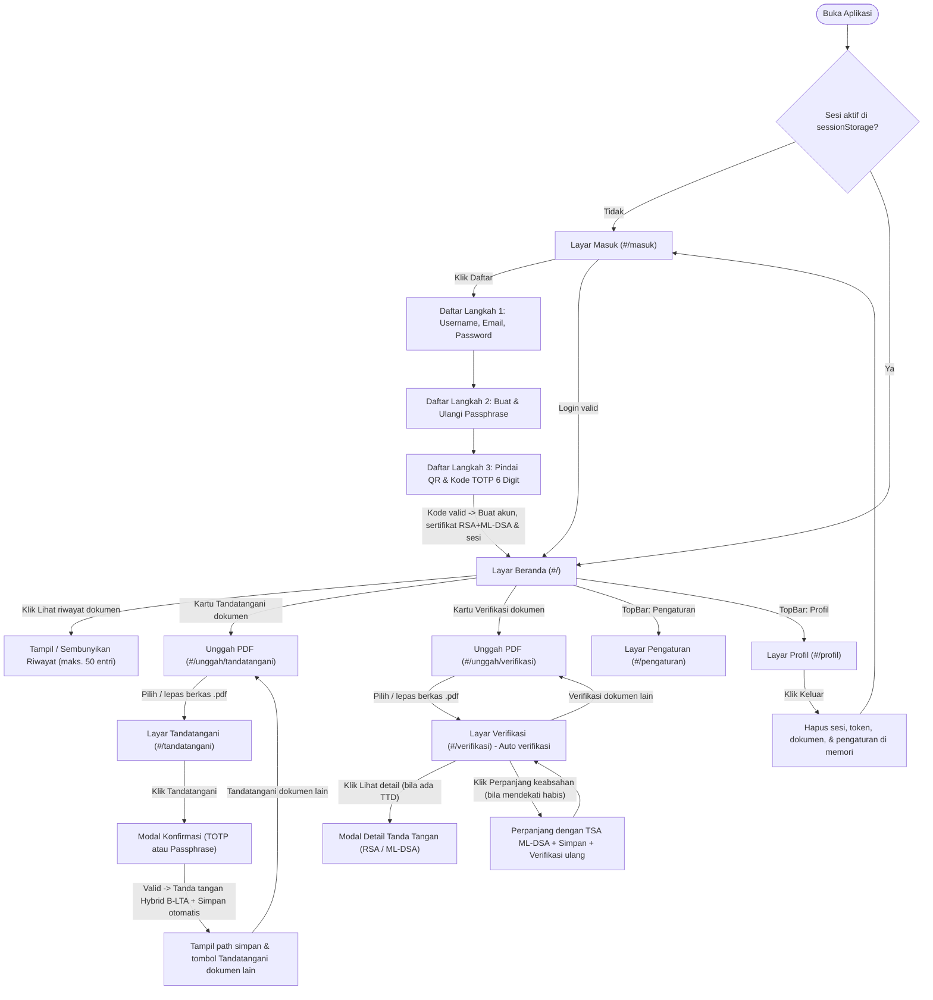
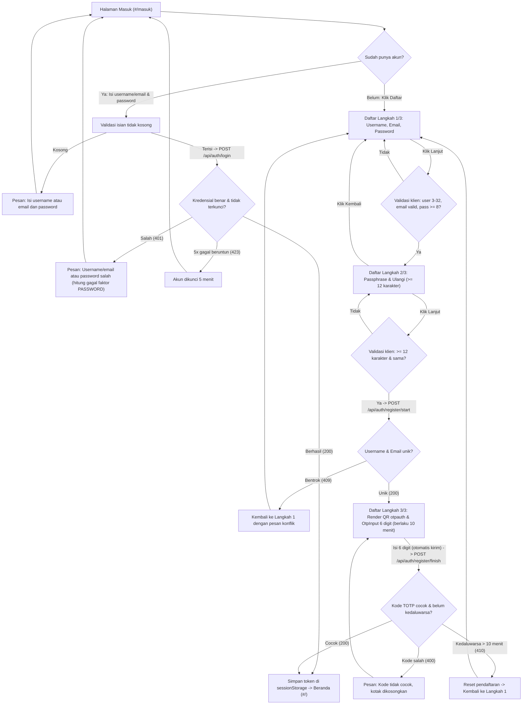
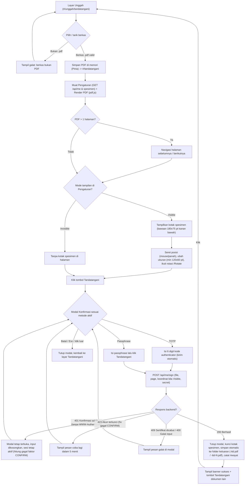
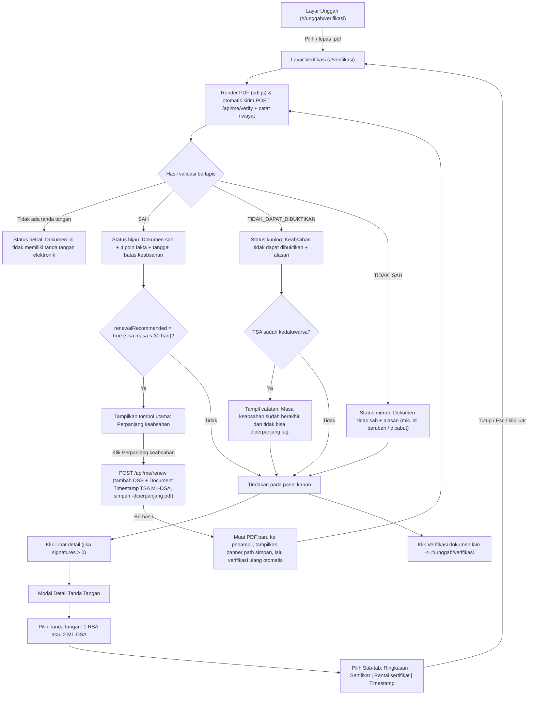
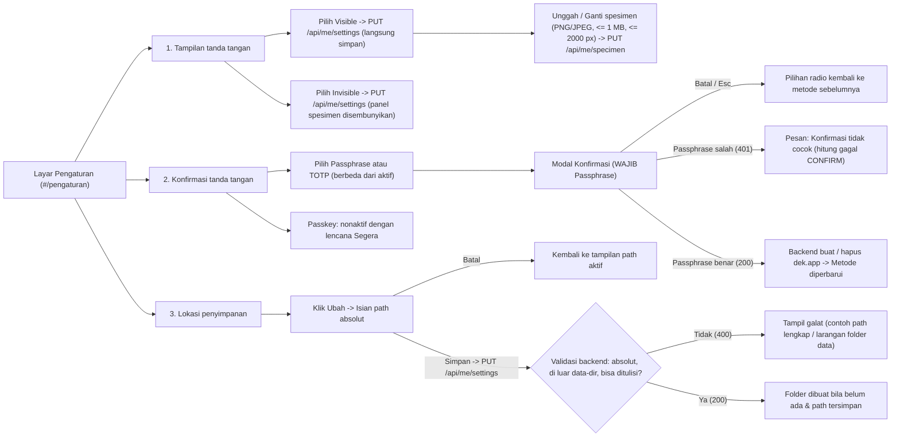

# User Flow Aplikasi SigningPQC

Dokumen ini memetakan seluruh alur pengguna (*user flow*) pada aplikasi **SigningPQC** (penandatanganan dan verifikasi PDF *hybrid* RSA-3072 + ML-DSA-65 dengan format PAdES B-LTA) berdasarkan implementasi aktual di `frontend/` (Vue 3 + Vue Router + Pinia + pdf.js) dan `backend/app-server/` (Spring Boot 4.2 + Bouncy Castle 1.87 + PDFBox 3.0.8) pada cabang `aplikasi-pengguna`.

---

## 1. Peta Layar, Rute, dan Navigasi

Aplikasi menggunakan *hash routing* (`createWebHashHistory`) agar kompatibel dengan pembungkusan desktop Electron. Terdapat **8 layar utama** dan **2 dialog modal**:

| Kategori | Layar / Modal | Rute | TopBar | Akses |
|---|---|---|---|---|
| Autentikasi (Publik) | **Masuk** (`MasukView`) | `#/masuk` | Tidak ada | Hanya tanpa sesi (jika sudah masuk, diarahkan ke `#/`) |
| Autentikasi (Publik) | **Daftar 3 Langkah** (`DaftarView`) | `#/daftar` | Tidak ada | Hanya tanpa sesi (jika sudah masuk, diarahkan ke `#/`) |
| Utama (Terlindungi) | **Beranda** (`BerandaView`) | `#/` | Ada (`Beranda` aktif) | Wajib sesi Bearer |
| Alur Dokumen | **Unggah PDF** (`UnggahView`) | `#/unggah/tandatangani` atau `#/unggah/verifikasi` | Ada (`Beranda` aktif) | Wajib sesi Bearer |
| Alur Dokumen | **Tandatangani** (`TandatanganiView`) | `#/tandatangani` | Ada (`Beranda` aktif) | Wajib sesi + PDF di memori (jika kosong -> `#/unggah/tandatangani`) |
| Alur Dokumen | **Verifikasi** (`VerifikasiView`) | `#/verifikasi` | Ada (`Beranda` aktif) | Wajib sesi + PDF di memori (jika kosong -> `#/unggah/verifikasi`) |
| Konfigurasi | **Pengaturan** (`PengaturanView`) | `#/pengaturan` | Ada (`Pengaturan` aktif) | Wajib sesi Bearer |
| Akun | **Profil** (`ProfilView`) | `#/profil` | Ada (`Profil` aktif) | Wajib sesi Bearer |
| Modal | **Dialog Konfirmasi** (`ConfirmDialog`) | Overlay di `Tandatangani` & `Pengaturan` | — | Meminta Passphrase atau TOTP 6 digit |
| Modal | **Detail Tanda Tangan** (`SignatureDetail`) | Overlay di `Verifikasi` | — | Menampilkan tab RSA & ML-DSA (4 sub-tab) |

> **Navigasi global (TopBar):** Tampil di semua layar terlindungi dengan 3 ikon di tengah: **Beranda** (`#/`), **Pengaturan** (`#/pengaturan`), dan **Profil** (`#/profil`). Rute tidak dikenal (`/:rest(.*)*`) dialihkan ke `#/`.

---

## 2. Alur Keseluruhan (End-to-End User Flow)

---

## 3. Rincian Alur per Fitur

### 3.1. Autentikasi: Masuk & Pendaftaran Akun Baru

Aplikasi menggunakan akun lokal di backend (`<data-dir>/accounts/<id>/`). Saat mendaftar, backend otomatis menerbitkan **pasangan sertifikat elektronik RSA-3072 dan ML-DSA-65** atas nama `CN=<username>`, mengenkripsi kunci privat dengan DEK (AES-256-GCM) yang dibungkus oleh *passphrase* (Argon2id) serta kunci aplikasi (untuk mode awal TOTP).

**Catatan penting alur autentikasi:**
- Metode konfirmasi awal setelah pendaftaran adalah **TOTP**, tampilan awal **Visible**, dan lokasi penyimpanan awal `${user.home}/output-signing`.
- Sesi disimpan di `sessionStorage` (otomatis hilang saat jendela/tab ditutup) dan di memori backend dengan batas menganggur **30 menit** serta batas mutlak **8 jam**.
- Jika di tengah penggunaan sesi berakhir (HTTP 401 dengan header `WWW-Authenticate: Bearer`), aplikasi otomatis membersihkan token, dokumen aktif, dan pengaturan di memori lalu mengembalikan pengguna ke `#/masuk`.

---

### 3.2. Beranda & Riwayat Dokumen

1. Pengguna disambut sesuai waktu lokal (*Selamat pagi / siang / sore / malam*).
2. Tersedia dua kartu aksi utama:
   - **Tandatangani dokumen** -> menuju `#/unggah/tandatangani`.
   - **Verifikasi dokumen** -> menuju `#/unggah/verifikasi`.
3. Tombol **Lihat riwayat dokumen** (toggle) memuat `GET /api/me/history` (maksimal 50 entri terbaru dari 200 yang tersimpan di `history.json`).
   - Jika belum ada aktivitas: tampil teks *"Belum ada riwayat..."*.
   - Jika ada: tampil daftar nama berkas, jenis kegiatan (`Ditandatangani`, `Diverifikasi`, `Diperpanjang`), waktu lokal, dan lencana status (`Sah`, `Tidak sah`, `Tidak dapat dibuktikan`, `Tanpa tanda tangan`, `Tidak diperiksa`).

---

### 3.3. Penandatanganan Dokumen (Hybrid RSA + ML-DSA, PAdES B-LTA)

Setiap penandatanganan dari aplikasi otomatis membubuhkan tanda tangan **RSA-3072** (tampil atau tersembunyi sesuai Pengaturan) + timestamp TSA RSA, lalu tanda tangan **ML-DSA-65** (selalu tersembunyi) + timestamp TSA ML-DSA, dilanjutkan penyematan data validasi (DSS) dan *document timestamp* TSA RSA G1 sehingga menghasilkan **PAdES B-LTA**.

**Detail perilaku penandatanganan:**
- Jika mode `Visible` tetapi pengguna belum mengunggah gambar spesimen di Pengaturan, petunjuk menampilkan *"Belum ada spesimen. Unggah di Pengaturan, sementara dipakai teks standar."* dan backend menggambar blok teks standar.
- Jika berkas keluaran bernama sama sudah ada di folder keluaran, backend otomatis menambahkan nomor urut (`nama-ttd-2.pdf`, `nama-ttd-3.pdf`, dst.) sehingga berkas lama tidak pernah tertimpa.

---

### 3.4. Verifikasi Dokumen, Detail Tanda Tangan, & Perpanjangan Keabsahan

---

### 3.5. Pengaturan

Layar `#/pengaturan` memuat tiga kartu konfigurasi yang langsung disinkronkan ke backend:

---

### 3.6. Profil & Keluar

1. Membuka `#/profil` memanggil `GET /api/me` untuk menampilkan:
   - Inisial pengguna (dari pemecahan `username`), username, email, dan tanggal terdaftar.
   - Kartu **Sertifikat elektronik** untuk **Sertifikat RSA** (`RSA 3072 bit`) dan **Sertifikat ML-DSA** (`ML-DSA-65, tahan kuantum`), masing-masing berisi: Status (`Aktif` hijau atau `Dicabut` merah), Algoritma, Penerbit, Nomor seri (format heksadesimal per 2 digit), dan Masa berlaku.
2. Menekan tombol **Keluar**:
   - Memanggil `POST /api/auth/logout` untuk menghapus token di backend.
   - Menjalankan `auth.clear()` yang menghapus token & username dari `sessionStorage`, serta mengosongkan store `document` (PDF di memori) dan `settings` (profil + `URL.revokeObjectURL` spesimen) agar data pengguna tidak tertinggal untuk pengguna berikutnya.
   - Mengarahkan ke `#/masuk`.

---

## 4. Ringkasan Aturan Penjaga (Guards) & Kondisi Batas

| Kondisi | Perilaku Aplikasi |
|---|---|
| Mengakses halaman terlindungi tanpa sesi | Router guard mengalihkan ke `#/masuk`. |
| Mengakses `#/masuk` atau `#/daftar` saat sudah masuk | Router guard mengalihkan ke `#/`. |
| Mengakses `#/tandatangani` atau `#/verifikasi` tanpa PDF di memori | Komponen mengalihkan ke `#/unggah/tandatangani` atau `#/unggah/verifikasi`. |
| Sesi menganggur > 30 menit, lewat > 8 jam, atau backend dimulai ulang | Backend mengirim `401` + `WWW-Authenticate: Bearer`; klien otomatis membersihkan sesi dan mengarahkan ke `#/masuk`. |
| Konfirmasi passphrase / TOTP salah saat tanda tangan atau ganti metode | Backend mengirim `401` **tanpa** `WWW-Authenticate`; klien menampilkan `"Konfirmasi tidak cocok"` di modal tanpa mengeluarkan pengguna. |
| 5 kegagalan beruntun pada faktor `PASSWORD` atau faktor `CONFIRM` | Akun dikunci 5 menit (`HTTP 423`). Penghitung kedua faktor dipisah sehingga login ulang tidak mereset hitungan tebakan konfirmasi (T-016). |
| Kode TOTP yang sama dipakai dua kali dalam 30 detik | Ditolak (`Konfirmasi tidak cocok`) karena backend menyimpan `lastTotpStep` per akun. |
| Sertifikat akun dicabut lewat `/api/pki/signers/{id}/revoke` | Profil menampilkan status `Dicabut`; percobaan tanda tangan ditolak (`409`: `"Sertifikat Anda sudah dicabut"`). |
| Folder keluaran berupa path relatif atau berada di dalam `<data-dir>` | Ditolak (`400`) sebelum folder dibuat (T-016). |

---

## 5. Catatan Jalur Pengembang (Di Luar Antarmuka Pengguna)

Selain endpoint aplikasi pengguna (`/api/auth/**` dan `/api/me/**`), backend `app-server` di `127.0.0.1:8085` tetap menyediakan endpoint lokal terbuka untuk pengujian, demo simulasi waktu (`at`), dan pengembangan:
- **PKI uji:** `GET /api/pki`, `POST /api/pki/setup`, `GET/POST /api/pki/signers`, `POST /api/pki/signers/{id}/revoke`, `GET /api/pki/crl/{caId}.crl`, `GET /api/pki/ca/{caId}.crt|.pem`.
- **TSA RFC 3161:** `POST /api/tsa/rsa`, `POST /api/tsa/mldsa`.
- **Tanda tangan & verifikasi pengembang:** `POST /api/sign` (pilihan level `B-B`, `B-T`, `B-LT`, `B-LTA` untuk penanda tangan uji non-akun) dan `POST /api/verify` (menerima parameter waktu simulasi `at`, tidak mencatat riwayat).
- **LTV & Pembaruan simulasi:** `POST /api/ltv/validation-data`, `POST /api/ltv/timestamp`, `POST /api/ltv/renew` (menerima `tsa=rsa-g1|rsa-g2|mldsa` dan waktu simulasi `at`).
