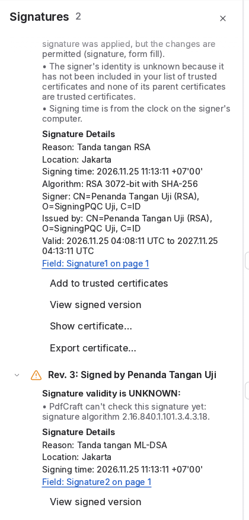

# T-002: PdfCraft tidak dapat memverifikasi tanda tangan ML-DSA-65

| Butir | Isi |
|---|---|
| Tanggal | Rabu, 25 November 2026 |
| Jenis | Temuan kompatibilitas |
| Sprint | 0 |
| Kebutuhan terkait | KNF-03; TC-02 |
| Lingkungan | Windows, PDF reader PdfCraft (versi belum dicatat) |
| Berkas uji | `backend\spike-output\01-hybrid.pdf` dari commit `9ad480c` |
| Status | Tercatat |

## Ringkasan

PDF hybrid dapat dibuka dan tanda tangan RSA terbaca, tetapi tanda tangan ML-DSA-65 berstatus UNKNOWN karena PdfCraft tidak mengenal OID algoritma ML-DSA-65. Tanda tangan ML-DSA tidak merusak dokumen dan tidak mengganggu pemeriksaan tanda tangan RSA.

## Langkah

1. Jalankan `SpikeMain` (lihat T-001) untuk menghasilkan `01-hybrid.pdf`.
2. Buka berkas di PdfCraft, lalu buka panel Signatures.

## Hasil

| Tanda tangan | Yang ditampilkan PdfCraft |
|---|---|
| Signature1 (RSA-3072, SHA-256) | Dokumen berubah setelah ditandatangani tetapi perubahannya diizinkan (penambahan tanda tangan). Identitas penanda tangan tidak dikenal karena sertifikat tidak ada di daftar tepercaya. Waktu tanda tangan berasal dari jam komputer penanda tangan. Detail: Algorithm RSA 3072-bit with SHA-256, Signer dan Issued by sama (self-signed), berlaku 25 Nov 2026 sampai 25 Nov 2027. |
| Signature2 (ML-DSA-65) | Rev. 3: Signature validity is UNKNOWN. "PdfCraft can't check this signature yet: signature algorithm 2.16.840.1.101.3.4.3.18." Reason, Location, dan Signing time tetap terbaca. |

Panel menampilkan 2 tanda tangan.

## Analisis

- OID 2.16.840.1.101.3.4.3.18 adalah ML-DSA-65 (FIPS 204, RFC 9881). PdfCraft belum mendukung algoritma ini. Temuan ini sejalan dengan kajian minggu ke-3 dan ke-4 bahwa pembaca PDF umum belum siap memverifikasi ML-DSA.
- Skema hybrid berurutan bekerja sesuai rancangan: reader yang tidak mengenal ML-DSA tetap bisa membuka dokumen dan memeriksa tanda tangan RSA. Tanda tangan ML-DSA tidak menyebabkan dokumen dianggap rusak.
- Peringatan "changes are permitted" pada tanda tangan RSA adalah perilaku yang benar, karena revisi sesudahnya hanya menambah tanda tangan.
- Status identitas tidak dikenal dan waktu dari jam lokal muncul karena Sprint 0 masih memakai sertifikat self-signed tanpa timestamp. Ini bukan masalah kompatibilitas.
- Karena reader umum belum mendukung ML-DSA, verifikator di aplikasi SigningPQC tetap diperlukan (KF-19 s.d. KF-23).

## Tindak lanjut

- Catat versi PdfCraft yang dipakai.
- Ulangi uji yang sama di Adobe Acrobat Reader sebagai pembanding.
- Ulangi setelah Sprint 1 (CA uji, timestamp, tanda tangan RSA visible). Harapannya, tanda tangan RSA berstatus sah setelah Root CA uji dipercaya, dan waktu tanda tangan berasal dari TSA.
