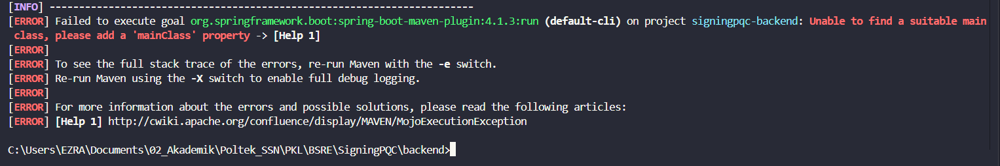

# T-003: spring-boot:run gagal pada build multi-modul

| Butir | Isi |
|---|---|
| Tanggal | Rabu, 25 November 2026 |
| Jenis | Bug |
| Sprint | 0 |
| Kebutuhan terkait | KF-38 (REST backend) |
| Lingkungan | Windows, JDK 21.0.8, Maven 3.9.11 (mvnw), Spring Boot 4.1.3 |
| Versi kode | ditemukan pada `9ad480c`, diperbaiki pada `f598fd4` |
| Status | Diperbaiki |

## Ringkasan

Perintah `.\mvnw.cmd -pl app-server -am spring-boot:run` gagal dengan pesan "Unable to find a suitable main class" pada proyek `signingpqc-backend`. Penyebabnya adalah konfigurasi Maven, bukan lingkungan laptop.

## Langkah

1. `cd backend`
2. `.\mvnw.cmd -pl app-server -am spring-boot:run`

## Hasil



```
Failed to execute goal org.springframework.boot:spring-boot-maven-plugin:4.1.3:run (default-cli)
on project signingpqc-backend: Unable to find a suitable main class, please add a 'mainClass' property
```

## Analisis

Opsi `-am` (also make) ikut membangun modul yang dibutuhkan `app-server`, yaitu pom induk `signingpqc-backend` dan `signer-core`. Goal `spring-boot:run` yang ditulis di baris perintah dijalankan pada semua modul itu. Pom induk dan `signer-core` bukan aplikasi, sehingga tidak memiliki kelas `main`.

## Perbaikan

- Pom induk: properti `spring-boot.run.skip` = `true`, diwarisi semua modul.
- `app-server/pom.xml`: properti `spring-boot.run.skip` = `false`.

Setelah perbaikan, perintah yang sama berjalan dan `http://127.0.0.1:8085/api/health` menjawab `{"status":"ok","java":"21.0.8","bouncyCastle":"1.87","pdfbox":"3.0.8"}`.

Catatan tambahan: membuka `http://127.0.0.1:8085/` menampilkan "Whitelabel Error Page" (404). Ini normal karena port 8085 hanya berisi REST API. Tampilan aplikasi ada di frontend Vue (`http://127.0.0.1:5173`).

## Tindak lanjut

Tidak ada. Perintah menjalankan backend di README tetap sama.
