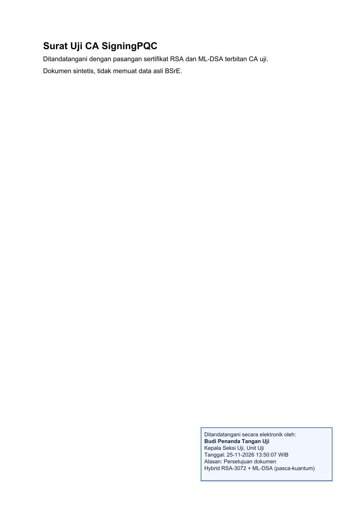

# T-008: Tanda tangan RSA visible dan ML-DSA invisible

| Butir | Isi |
|---|---|
| Tanggal | 25 Nov 2026 |
| Jenis | Pengujian |
| Sprint | 1 (dikerjakan lebih awal) |
| Kebutuhan terkait | KF-12 s.d. KF-15, TC-01 (bagian tampilan) |
| Lingkungan | Windows 11 (laptop), Temurin JDK 25.0.5.1, PDFBox 3.0.8 (render halaman memakai PDFRenderer PDFBox) |
| Versi kode | commit "Sprint 1: tanda tangan RSA visible" |
| Status | Lulus (belum dicek di PdfCraft/Adobe, lihat tindak lanjut) |

## Ringkasan
Tanda tangan RSA sekarang tampil sebagai kotak di halaman. Tanda tangan ML-DSA tetap tersembunyi dan menutup
seluruh dokumen, dan keduanya berlevel B-T. Ada 4 uji JUnit baru, sehingga total uji menjadi 29 (4 di signer-core
dan 25 di pki-test). Semuanya lolos di laptop.

## Langkah
1. `cd backend`, set `JAVA_HOME` ke JDK 25, lalu `.\mvnw.cmd -B clean install`.
2. `.\mvnw.cmd -B -q -pl pki-test exec:java`. Demo ini membuat `04-hybrid-visible-bt.pdf` dan gambar halaman 1,
   `04-halaman1.png`.
3. Buka `backend\pki-output\04-hybrid-visible-bt.pdf` di pembaca PDF.

## Hasil

Isi kotak tanda tangan (220 x 90 point, kanan bawah halaman 1, margin 40 point):
- Ditandatangani secara elektronik oleh:
- **nama penanda tangan** (tebal)
- baris tambahan, misalnya jabatan dan unit
- Tanggal dalam WIB, sama dengan /M di kamus tanda tangan
- Alasan
- "Hybrid RSA-3072 + ML-DSA (pasca-kuantum)"

Ukuran huruf menyesuaikan otomatis antara 5 dan 9 pt agar semua baris muat di dalam kotak.

Uji JUnit `VisibleSignatureTest` (4 uji, semua lolos):

| Uji | Hasil |
|---|---|
| RSA visible + ML-DSA invisible, keduanya sah dan berlevel B-T, dan ML-DSA menutup seluruh dokumen | Lolos |
| Widget RSA berukuran 220 x 90 di halaman 1 dan punya appearance stream, sedangkan widget ML-DSA berukuran 0 (invisible) | Lolos |
| Halaman dirender, dan kotak berisi piksel gelap (bingkai dan teks tergambar) | Lolos |
| Posisi di luar halaman atau nomor halaman yang tidak ada ditolak (IllegalArgumentException) | Lolos |

Uji silang OpenSSL dari T-007 tetap 27 dari 27 sesuai harapan setelah perubahan ini.

## Analisis
- Tampilan dibuat dengan pola templat PDFBox (CreateVisibleSignature2): widget dan appearance stream dibuat di
  dokumen templat, lalu digabungkan saat `addSignature`. Tampilan masuk ke revisi yang ditandatangani RSA, jadi
  kotaknya juga dilindungi oleh tanda tangan RSA dan ML-DSA.
- Huruf memakai Helvetica (Standard 14) yang tidak disematkan. Ini cukup untuk prototipe. Bila nanti dibutuhkan
  PDF/A, huruf harus disematkan.
- Halaman yang diputar (/Rotate) belum ditangani. Untuk prototipe, posisi diasumsikan pada halaman tanpa rotasi.
- Kalimat "Hybrid ... + ML-DSA" ditulis pada tanda tangan RSA, karena tanda tangan ML-DSA dibuat sesudahnya pada
  alur yang sama. Bila alur ML-DSA gagal, aplikasi harus membatalkan seluruh proses agar teks ini tidak menyesatkan.
  Hal ini dicatat untuk orkestrasi di endpoint REST (langkah 5).

## Tindak lanjut
- Buka `04-hybrid-visible-bt.pdf` di PdfCraft dan Adobe Reader, lalu catat tampilan dan status kedua tanda tangan
  dan timestamp-nya (langkah 6).
- Langkah 5: endpoint REST untuk tanda tangan hybrid (posisi kotak dari antarmuka Vue) dan uji vektor NIST ACVP.
