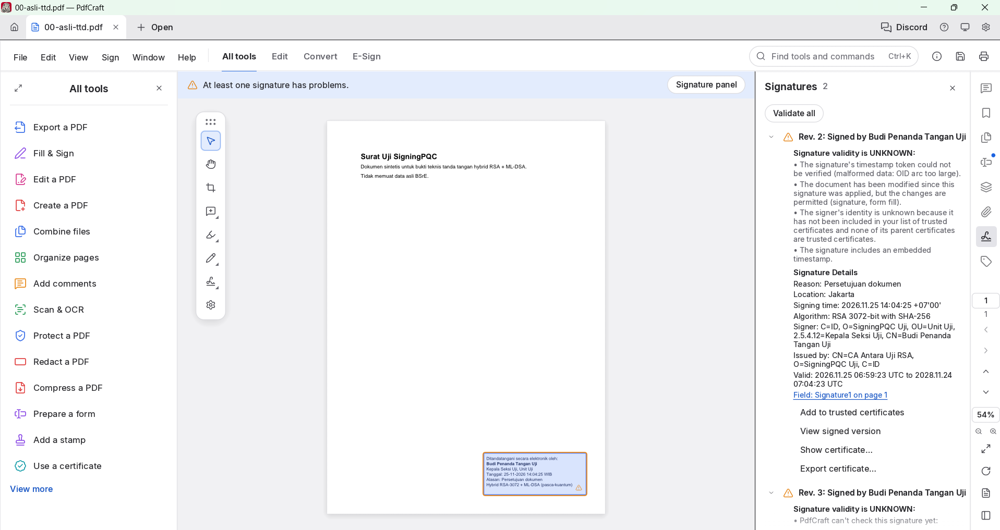
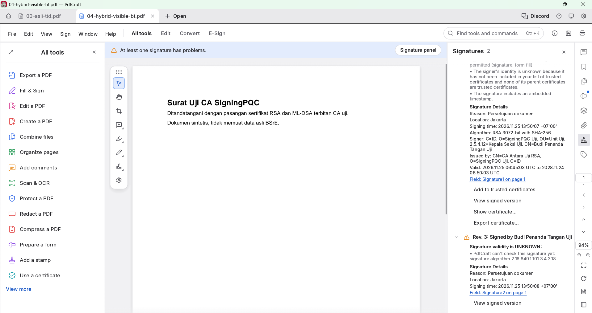
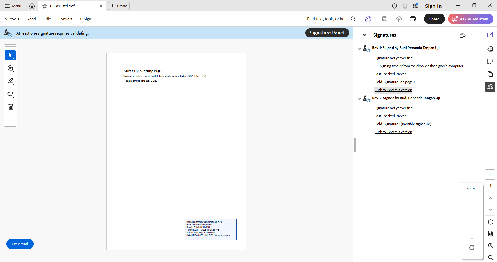
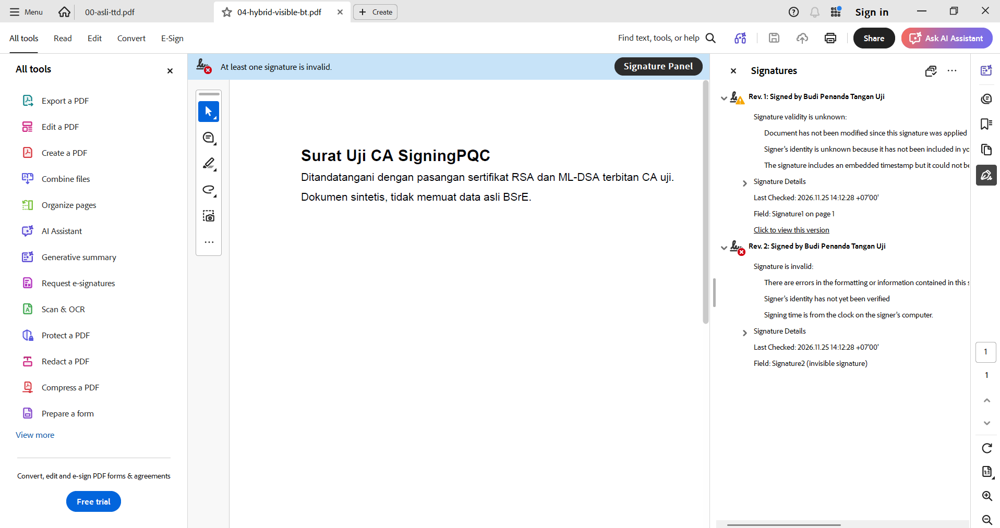
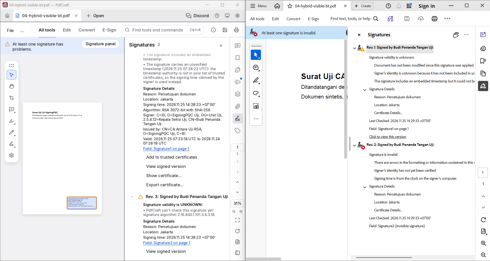
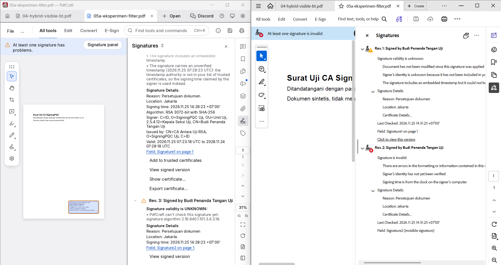
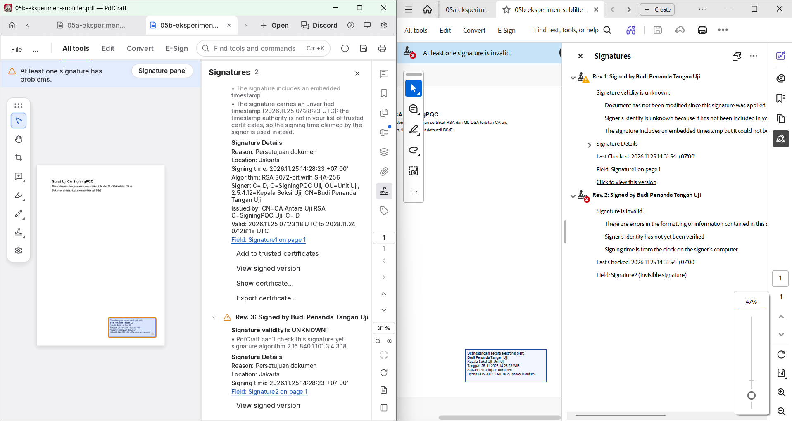

# T-011: Uji ulang di PdfCraft dan Adobe: OID kebijakan TSA ditolak, ML-DSA dianggap tidak sah oleh Adobe

| Butir | Isi |
|---|---|
| Tanggal | 25 Nov 2026 |
| Jenis | Pengujian, bug, dan temuan kompatibilitas |
| Sprint | 1 (langkah 6: uji ulang di pembaca PDF) |
| Kebutuhan terkait | KNF-03, TC-02, KF tanda tangan visible dan B-T |
| Lingkungan | Windows 11 (laptop), PdfCraft (versi belum dicatat), Adobe Acrobat Reader (versi belum dicatat), Temurin JDK 25.0.5, OpenSSL 3.5.9 |
| Berkas uji | `00-asli-ttd.pdf` (hasil REST, T-010) dan `backend\pki-output\04-hybrid-visible-bt.pdf` (T-008) |
| Status | Bug OID diperbaiki dan terbukti di PdfCraft. ML-DSA tetap tidak sah di Adobe pada semua varian. Keputusan desain menunggu pengguna |

## Ringkasan
Kotak tanda tangan RSA tampil benar di PdfCraft dan Adobe, dan kedua pembaca menyatakan dokumen tidak berubah
sejak tanda tangan RSA. Ada tiga temuan. (1) PdfCraft tidak bisa membaca token timestamp karena OID kebijakan TSA
uji punya arc 128 bit ("OID arc too large"); OID sudah diganti. (2) Adobe menandai tanda tangan ML-DSA sebagai
**tidak sah** ("errors in the formatting"), bukan "tidak diketahui" seperti harapan TC-02, sehingga seluruh dokumen
berstatus "At least one signature is invalid". (3) Skrip `cek-pki.ps1` punya bug tersembunyi: `openssl cms -verify`
tanpa `-binary` mengubah byte 0x0A menjadi 0x0D 0x0A, yang baru muncul setelah OID diganti. Setelah perbaikan,
PdfCraft membaca token timestamp dengan benar. Eksperimen mengganti /Filter atau /SubFilter ML-DSA tidak mengubah
penilaian Adobe: ML-DSA tetap "Signature is invalid".

## Langkah
1. Buka `00-asli-ttd.pdf` dan `04-hybrid-visible-bt.pdf` di PdfCraft dan Adobe Acrobat Reader, lalu buka panel
   tanda tangan. Di Adobe, klik "Validate all signatures".
2. Perbaikan OID: ganti `LocalTsa.TEST_POLICY`, tambah uji regresi, lalu `.\mvnw.cmd -B clean install`.
3. Tutup PDF lama di Adobe, lalu buat ulang PDF demo: `.\mvnw.cmd -B -q -pl pki-test exec:java`.
4. `scripts\cek-pki.ps1`.
5. Buka ulang `04-hybrid-visible-bt.pdf`, `05a-eksperimen-filter.pdf` dan `05b-eksperimen-subfilter.pdf` di PdfCraft
   dan Adobe (Adobe: Validate all signatures).

## Hasil

### Sebelum perbaikan (screenshot pengguna)

| Pembaca | Tanda tangan RSA (visible) | Tanda tangan ML-DSA (invisible) | Status dokumen |
|---|---|---|---|
| PdfCraft | UNKNOWN. Kotak tampil. Identitas tidak dipercaya (CA uji). Token timestamp gagal dibaca: **malformed data: OID arc too large**. Perubahan sesudahnya diizinkan (signature, form fill) | UNKNOWN: "PdfCraft can't check this signature yet: signature algorithm 2.16.840.1.101.3.4.3.18" | At least one signature has problems |
| Adobe (belum divalidasi) | Signature not yet verified, waktu dari jam komputer penanda tangan | Signature not yet verified | At least one signature requires validating |
| Adobe (sesudah validasi) | Validity unknown. "Document has not been modified since this signature was applied". Identitas tidak dikenal. "The signature includes an embedded timestamp but it could not be verified" | **Signature is invalid**: "There are errors in the formatting or information contained in this signature" | **At least one signature is invalid** |

Kedua pembaca menampilkan atribut jabatan sebagai `2.5.4.12=Kepala Seksi Uji`, karena atribut title tidak punya
singkatan baku di tampilan mereka. Ini hanya kosmetik.

### Sesudah perbaikan OID (laptop)
- OID kebijakan baru `1.3.6.1.4.1.32473.1.1`. Nomor enterprise 32473 dicadangkan untuk dokumentasi (RFC 5612).
  Semua arc muat dalam 32 bit.
- `openssl asn1parse` atas TSTInfo ML-DSA: `OBJECT :1.3.6.1.4.1.32473.1.1`. `openssl ts -reply -text` atas token
  RSA: `Policy OID: 1.3.6.1.4.1.32473.1.1`.
- Uji JUnit: 42 lolos (7 signer-core, 27 pki-test, 8 app-server). Ada 2 uji baru:
  - `LocalTsaTest.semuaOidDiTokenPunyaArcKecil`: menelusuri seluruh struktur ASN.1 token RSA dan ML-DSA
    (termasuk sertifikat TSA dan TSTInfo) dan memastikan tidak ada arc OID lebih dari 32 bit.
  - `PadesTimestampTest.namaHandlerEksperimenTercatatDanCmsTetapSah`: untuk eksperimen di bawah.
  Uji ini dihapus lagi bersama kode eksperimen, jadi jumlah akhir 41 uji lolos (7 signer-core, 26 pki-test,
  8 app-server).
- `cek-pki.ps1`: 27 dari 27 sesuai harapan (setelah perbaikan `-binary`).

### Bug skrip cek-pki yang ikut terungkap
Setelah OID diganti, dua pemeriksaan imprint ML-DSA di `cek-pki.ps1` gagal. Penyebabnya bukan token, tetapi
`openssl cms -verify ... -out tstinfo.der` tanpa `-binary`. Tanpa opsi itu, OpenSSL memperlakukan isi sebagai teks
S/MIME dan di Windows mengganti setiap byte 0x0A (LF) dengan 0x0D 0x0A (CRLF). OID baru panjangnya 10 byte, jadi
byte panjangnya adalah 0x0A, dan TSTInfo menjadi rusak (`asn1parse` membaca OID `0.10.43...`). OID lama kebetulan
tidak memuat byte 0x0A. Perbaikan: tambah `-binary` pada dua perintah `openssl cms -verify` yang menulis TSTInfo.

### Uji ulang sesudah perbaikan (screenshot pengguna, PDF dibuat 14:28 WIB)

| Berkas | PdfCraft: RSA | PdfCraft: ML-DSA | Adobe: RSA | Adobe: ML-DSA |
|---|---|---|---|---|
| `04-hybrid-visible-bt.pdf` | UNKNOWN (CA tidak dipercaya). Token timestamp **terbaca**: "unverified timestamp (2026.11.25 07:28:23 UTC): the timestamp authority is not in your list of trusted certificates" | UNKNOWN, algoritma 2.16.840.1.101.3.4.3.18 belum didukung | Validity unknown, dokumen tidak berubah, timestamp "could not be verified" | **Signature is invalid** (errors in the formatting) |
| `05a-eksperimen-filter.pdf` | Sama seperti 04 | Sama seperti 04 | Sama seperti 04 | **Signature is invalid** |
| `05b-eksperimen-subfilter.pdf` | Sama seperti 04 | Sama seperti 04 | Sama seperti 04 | **Signature is invalid** |

Pesan "OID arc too large" tidak muncul lagi. PdfCraft sekarang mengenali timestamp, dan menolaknya hanya karena TSA
uji belum ada di daftar sertifikat tepercaya. Ini perilaku yang benar untuk PKI uji.

## Analisis
1. **OID kebijakan TSA.** OID 2.25.&lt;UUID&gt; sah menurut X.660 dan ITU-T X.667, tetapi banyak pustaka
   membatasi arc OID ke 64 bit. PdfCraft gagal membaca token, sehingga timestamp tidak bisa dipakai sama sekali.
   TSA produksi (misalnya TSA BSrE) memakai OID terdaftar dengan arc kecil, jadi masalah ini khusus PKI uji. Uji
   regresi baru mencegah OID besar muncul lagi di token.
2. **Timestamp RSA di Adobe "could not be verified".** Setelah perbaikan OID, kemungkinan besar Adobe tetap
   menampilkan peringatan ini selama sertifikat TSA uji belum dipercaya. Ini perlu diuji ulang. Bila Root CA Uji RSA
   ditambahkan ke daftar sertifikat tepercaya Adobe, tanda tangan RSA dan timestamp-nya seharusnya menjadi sah.
3. **Adobe menandai ML-DSA tidak sah.** Adobe belum mengenal OID ML-DSA. Bila kamus tanda tangan memakai handler
   standar (Adobe.PPKLite dengan ETSI.CAdES.detached), Adobe tampaknya menganggap algoritma yang tidak dikenal sebagai
   kesalahan format, bukan sebagai "tidak diketahui". Akibatnya, untuk pengguna Adobe, dokumen hybrid terlihat rusak
   walaupun tanda tangan RSA utuh. Ini menyimpang dari harapan TC-02. Ini juga risiko nyata bagi adopsi skema hybrid
   "dua tanda tangan berurutan", karena Adobe adalah pembaca yang paling banyak dipakai.
4. **Tanda tangan ML-DSA tetap sah secara kriptografis.** Verifier aplikasi (Bouncy Castle) dan `openssl cms`
   memverifikasinya. Masalahnya ada pada dukungan pembaca, bukan pada struktur CMS.

### Eksperimen untuk temuan Adobe
Untuk melihat apakah Adobe bisa menampilkan ML-DSA sebagai "tidak diketahui", PDF demo sekarang juga membuat dua
varian. Hanya nama handler pada kamus tanda tangan ML-DSA yang diganti. Tanda tangan RSA dan isi CMS tidak berubah.

| Berkas | /Filter ML-DSA | /SubFilter ML-DSA | Sesuai PAdES? |
|---|---|---|---|
| `04-hybrid-visible-bt.pdf` | Adobe.PPKLite | ETSI.CAdES.detached | Ya (konfigurasi saat ini) |
| `05a-eksperimen-filter.pdf` | SigningPQC.PQC | ETSI.CAdES.detached | Filter tidak baku |
| `05b-eksperimen-subfilter.pdf` | Adobe.PPKLite | SigningPQC.CAdES.MLDSA | Tidak (SubFilter wajib ETSI.CAdES.detached untuk PAdES) |

Verifier aplikasi menyatakan kedua tanda tangan di 05a dan 05b sah. Varian ini hanya untuk uji di pembaca.

**Hasil eksperimen:** Adobe tetap menyatakan ML-DSA "Signature is invalid" pada ketiga berkas. Jadi Adobe tidak
memilih penilaian berdasarkan nama handler. Adobe tetap membaca CMS, lalu menolak algoritma yang tidak dikenalnya
sebagai kesalahan format. Selama tanda tangan ML-DSA berupa field tanda tangan PDF sendiri, Adobe akan menandainya
tidak sah sampai Adobe mendukung ML-DSA. Karena eksperimen tidak membantu, `PadesSigner.withDictionaryNames` dan
varian 05a/05b dihapus lagi dari kode, supaya aplikasi hanya membuat kamus yang sesuai PAdES.

Pilihan yang tersisa:
1. **Terima dan dokumentasikan.** Struktur dua tanda tangan berurutan tetap dipakai. TC-02 direvisi: di Adobe,
   tanda tangan ML-DSA tampil tidak sah sampai Adobe mendukung ML-DSA, dan verifier aplikasi menjadi acuan.
2. **Struktur alternatif.** ML-DSA tidak dibuat sebagai field tanda tangan sendiri, tetapi disisipkan di dalam CMS
   RSA sebagai atribut unsigned (mirip cara signature timestamp disisipkan). Adobe kemungkinan mengabaikan atribut
   yang tidak dikenalnya, jadi hanya tanda tangan RSA yang terlihat. Ini mengubah desain yang sudah dipilih dan
   perlu diuji dulu di Adobe.

## Tindak lanjut
- Keputusan pengguna: pilihan 1 atau 2 di atas. Hasilnya dicatat di sini dan di dokumen kebutuhan (TC-02).
- Opsional: tambahkan `rsa-root.pem` ke sertifikat tepercaya Adobe (Edit > Preferences > Signatures > Identities &
  Trusted Certificates) untuk melihat status RSA dan timestamp saat CA dipercaya.
- Catat versi PdfCraft dan Adobe Reader (Help > About) untuk T-002 dan T-011.
