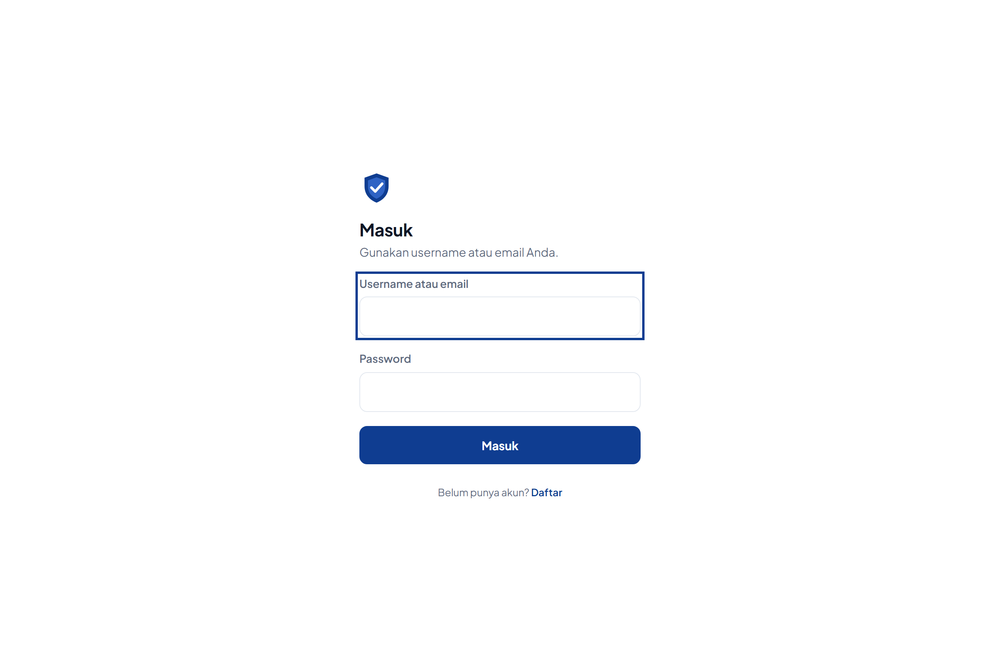
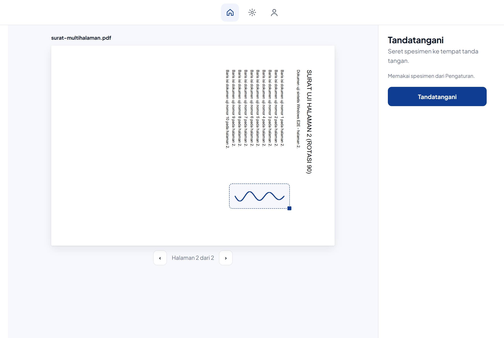
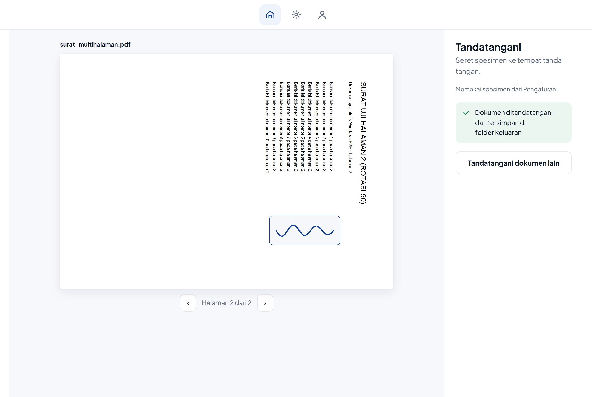
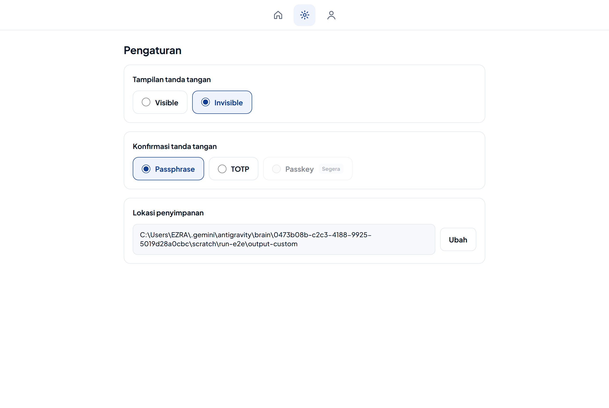
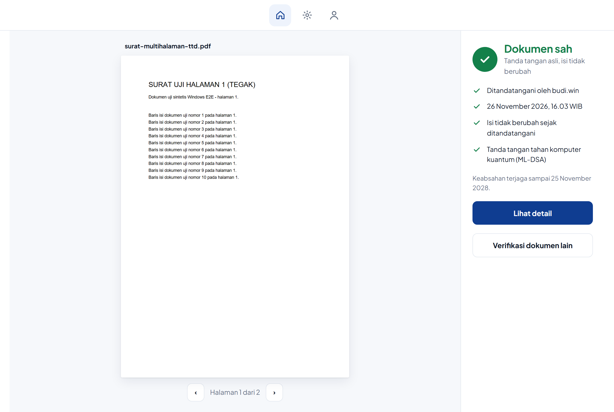
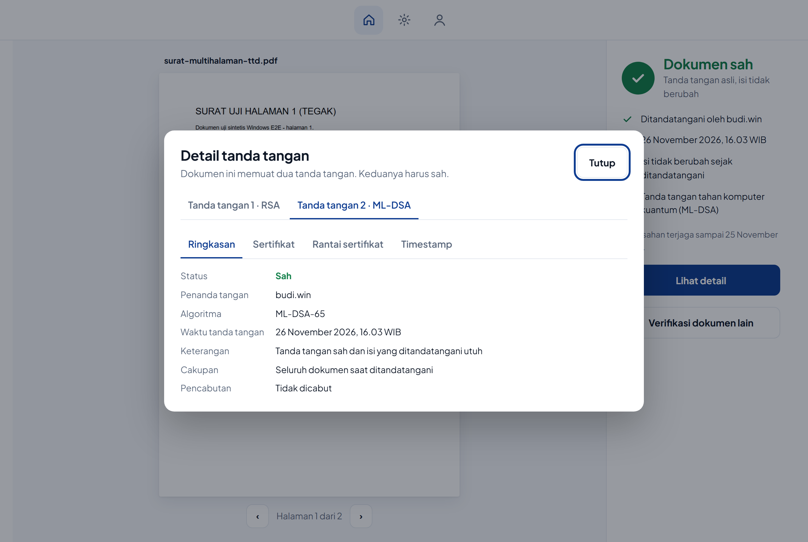
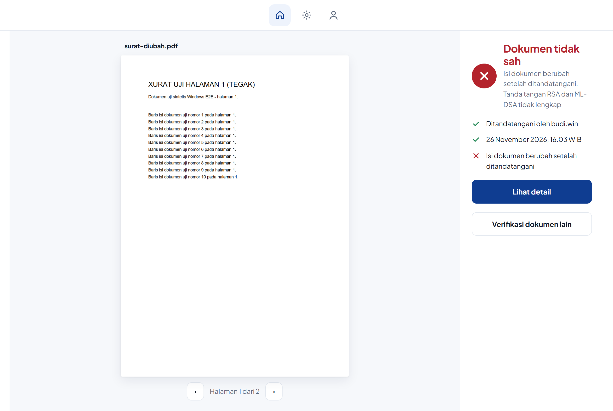
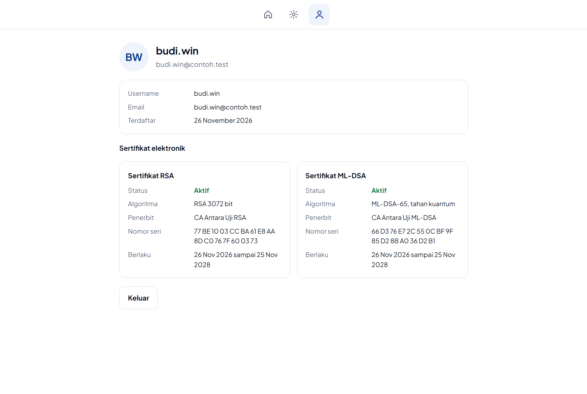
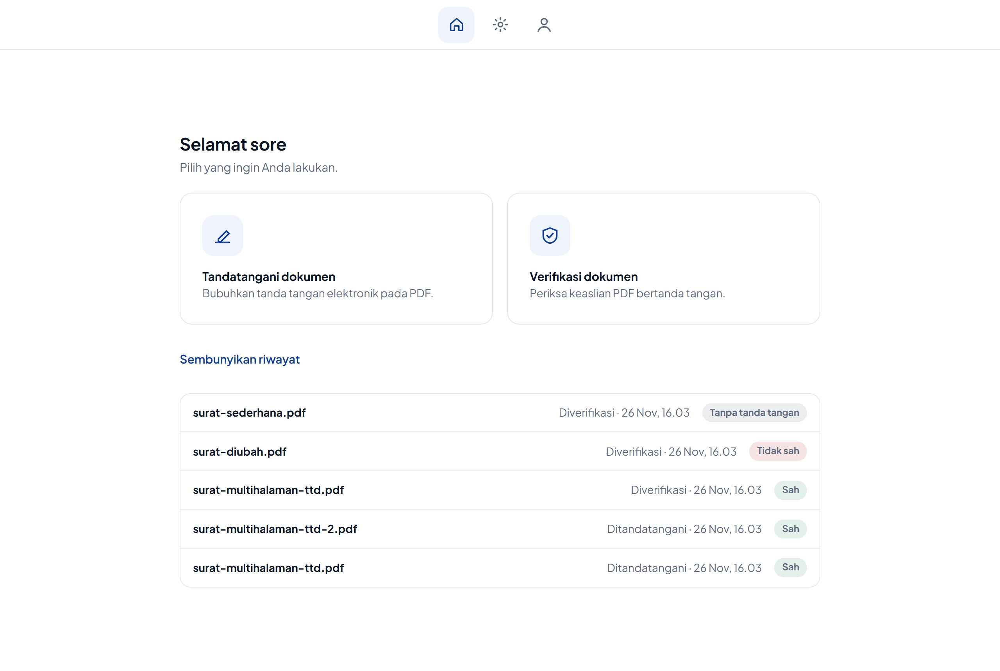

# T-018: Uji langsung di browser Windows dan temuan intersepsi HTTP 204 pada respons PDF

| Butir | Isi |
|---|---|
| Tanggal | 26 Nov 2026 |
| Jenis | Pengujian dan temuan kompatibilitas |
| Sprint | 3 (aplikasi pengguna) |
| Kebutuhan terkait | Tindak lanjut T-015 (uji browser Windows), T-016 (keamanan akun & folder keluaran), KF-11 s.d. KF-24, KF-31 s.d. KF-35 |
| Lingkungan | Windows 11, Eclipse Temurin JDK 25.0.5.1+2 LTS, Spring Boot 4.2.0 (`app-server-0.1.0-SNAPSHOT.jar`), Node.js v24.22.1, npm 10.8.2, Vite 8.3.6, Vue 3.5.44, pdfjs-dist 6.5.438, Google Chrome headless (CDP) 1280 x 860 @ 2x DPR |
| Versi kode | branch `aplikasi-pengguna`, commit `097f229` |
| Status | Lulus dengan temuan (31 langkah lolos tanpa galat JS; 1 temuan penting intersepsi HTTP 204 di Windows, 3 catatan minor UX) |

## Ringkasan

Seluruh 8 layar aplikasi pengguna diuji langsung di Windows menggunakan backend `app-server` (JDK 25) dan frontend Vite + Vue melalui Google Chrome (CDP) dalam lingkungan data dan port terisolasi (`18085` dan `15173`). Seluruh 31 langkah alur utama, validasi formulir, pengamanan folder keluaran T-016, PDF 2 halaman termasuk halaman berotasi `/Rotate 90`, tanda tangan Visible (TOTP) dan Invisible (Passphrase), verifikasi (sah, diubah 1 byte, tanpa tanda tangan), detail sertifikat ML-DSA, profil, riwayat, keluar, dan masuk kembali berjalan tanpa galat JavaScript.

Uji ini menemukan **1 masalah kompatibilitas penting pada lingkungan Windows**: respons `POST /api/me/sign` yang membawa header `Content-Disposition: attachment` dan `Content-Type: application/pdf` diintersepsi di klien Windows menjadi `HTTP 204 No Content` (`Pragma: no-cache`, `Cache-Control: no-cache`, `Connection: close`) — pola khas *download manager* berbasis WFP/browser integration seperti IDM — sehingga header `X-Saved-Path` hilang di frontend dan tampilan menampilkan fallback `folder keluaran`, serta berisiko menggagalkan `POST /api/me/renew`.

## Langkah

1. Menjalankan uji unit frontend: `cd frontend && npm test` (39/39 uji pada 7 berkas lolos).
2. Memaketkan backend terbaru di JDK 25: `cd backend && .\mvnw.cmd -B -DskipTests -pl app-server -am package` (BUILD SUCCESS dalam 8,54 detik).
3. Menjalankan backend pada port terisolasi `18085` dengan folder data dan keluaran sementara (`--server.port=18085 --signingpqc.data-dir=... --signingpqc.default-output-dir=...`), dan Vite pada port `15173` yang meneruskan `/api` ke `127.0.0.1:18085`.
4. Menyiapkan berkas uji sintetis:
   - `surat-multihalaman.pdf` (2.610 B): 2 halaman, halaman 1 A4 tegak dan halaman 2 A4 `/Rotate 90`.
   - `surat-sederhana.pdf` (1.453 B): 1 halaman A4 tegak tanpa tanda tangan.
   - `bukan-pdf.txt` (21 B): berkas teks biasa untuk uji penolakan `DropZone`.
   - `spesimen-uji.png` (1.076 B): gambar PNG 360 x 120 px sintetis.
5. Menjalankan 31 langkah ujung-ke-ujung pada Chrome headless (1280 x 860, DPR 2) lewat Chrome DevTools Protocol (CDP), memantau header jaringan `/api/me/sign`, `Runtime.exceptionThrown`, dan `Runtime.consoleAPICalled`.

## Hasil

### Ringkasan uji otomatis dan kinerja

| Pengukuran | Hasil |
|---|---|
| Uji unit frontend (`vitest run`) | 7 berkas, 39/39 lolos |
| Build paket backend (`mvnw package`, JDK 25) | BUILD SUCCESS (8,54 detik) |
| Startup backend + auto-setup PKI uji (RSA + ML-DSA + 3 TSA) | 8,47 detik |
| Durasi tanda tangan Visible B-LTA (TOTP, PDF 2 halaman) | 1.874 ms (target KNF-02 <= 2.000 ms) |
| Durasi tanda tangan Invisible B-LTA (Passphrase + Argon2id) | 1.626 ms (target KNF-02 <= 2.000 ms) |
| Ukuran berkas PDF | Asli: 2.610 B -> Visible B-LTA: 340.658 B (~333 KB) -> Invisible B-LTA: 338.240 B (~330 KB) |
| Galat JavaScript / konsol browser | Tidak ada (0 `pageerror`, 0 `console.error`) |

### Ringkasan 31 langkah uji di browser Windows

| No | Skenario | Hasil |
|---|---|---|
| 1-2 | Startup backend (auto-setup PKI 3 TSA) & Vite | Berhasil (`ready=true`, `org=SigningPQC Uji`) |
| 3-4 | Guard tanpa sesi (`#/` dan `#/profil`) | Otomatis diarahkan ke `#/masuk` |
| 5-8 | Daftar 3 langkah: validasi password pendek, passphrase tidak cocok, QR TOTP tampil, kode TOTP salah ditolak | Semua pesan sesuai (`Password minimal 8 karakter`, `Passphrase dan ulangannya tidak sama`, `Kode tidak cocok`) |
| 9-10 | Selesai daftar -> Beranda & cek riwayat awal | Masuk otomatis, sapaan `Selamat sore`, riwayat menampilkan `Belum ada riwayat...` |
| 11-14 | Pengaturan: Passkey nonaktif, unggah spesimen PNG, tolak folder relatif, tolak folder di dalam `data-dir` (T-016), simpan folder absolut baru | Semua tepat; path di dalam `data-dir` ditolak: `Folder keluaran tidak boleh berada di dalam folder data aplikasi` |
| 14.5 | Akses langsung `#/tandatangani` dan `#/verifikasi` tanpa PDF | Diarahkan ke `#/unggah/tandatangani` dan `#/unggah/verifikasi` |
| 15-17 | Unggah non-PDF ditolak; unggah PDF 2 halaman; pindah ke halaman 2 (`/Rotate 90`) dan geser kotak spesimen | Non-PDF ditolak; halaman 2 tampil lanskap; kotak spesimen bergeser dari `(662, 527)` ke `(582, 467)` |
| 18-19 | Konfirmasi TOTP salah saat tanda tangan -> tetap masuk; TOTP valid periode berikutnya -> berhasil | Berkas `surat-multihalaman-ttd.pdf` (340.658 B) tersimpan di disk & tercatat di `history.json`, namun browser menerima **HTTP 204** (lihat Temuan 1) |
| 20-22 | Pengaturan ke Invisible; batal ganti ke Passphrase (tetap TOTP); passphrase salah lalu benar; tanda tangan ulang berkas sama | Kotak spesimen tidak tampil (`0`); berkas tersimpan sebagai `surat-multihalaman-ttd-2.pdf` (338.240 B) tanpa menimpa berkas pertama; browser juga menerima HTTP 204 |
| 23-24 | Verifikasi `surat-multihalaman-ttd.pdf` dan buka dialog `Lihat detail` (tab `ML-DSA`: Ringkasan, Sertifikat, Rantai, Timestamp) | `Dokumen sah`, 4 butir fakta, berlaku sampai `25 November 2028`; rantai 3 tingkat ke `Root CA Uji ML-DSA` (`Root tepercaya`), timestamp `TSA Uji ML-DSA` (`ML-DSA-65`, `SHA-512, cocok`) |
| 25-26 | Verifikasi dokumen diubah 1 byte & PDF tanpa tanda tangan | Diubah: `Dokumen tidak sah`; Tanpa tanda tangan: `Dokumen ini tidak memiliki tanda tangan elektronik` (tombol `Lihat detail` tidak tampil) |
| 27-28 | Profil & Riwayat lengkap di Beranda | Inisial `BW`, dua kartu sertifikat (`Sertifikat RSA: Aktif`, `Sertifikat ML-DSA: Aktif`); 5 entri riwayat tampil berurutan dengan chip status berwarna |
| 29-31 | Guard halaman publik saat sudah masuk (`#/masuk` -> `#/`), Keluar, Masuk kembali dengan email (password salah lalu benar) | Token terhapus saat keluar (`null`), password salah ditolak dengan pesan seragam, masuk ulang berhasil |

### Tangkapan layar

| Layar / Skenario | Berkas |
|---|---|
| Masuk (tampak kotak fokus pada `label.field`) |  |
| Tandatangani halaman 2 (`/Rotate 90`) setelah digeser |  |
| Berhasil tanda tangan (tampak fallback `folder keluaran` akibat HTTP 204) |  |
| Pengaturan (Invisible + Passphrase + folder kustom) |  |
| Verifikasi dokumen sah (2 halaman) |  |
| Dialog Lihat detail (tab ML-DSA Ringkasan) |  |
| Verifikasi dokumen diubah 1 byte |  |
| Profil (dua sertifikat Aktif) |  |
| Beranda dengan 5 entri riwayat |  |

## Analisis

### Temuan 1 (Penting): Intersepsi HTTP 204 pada `POST /api/me/sign` oleh pengelola unduhan di Windows
- **Gejala.** Pada langkah 19 dan 22, Chrome menerima respons `HTTP 204 No Content` dengan header `{"Pragma":"no-cache","Cache-Control":"no-cache","Connection":"close"}` pada `POST /api/me/sign`. Akibatnya, `response.headers.get('X-Saved-Path')` bernilai `null`, sehingga banner sukses di `TandatanganiView.vue` menampilkan teks cadangan `folder keluaran` alih-alih path lengkap berkas. Berkas PDF sendiri tetap tersimpan dengan benar di folder keluaran dan tercatat lengkap di `history.json`.
- **Penyebab.** `MeDocumentController.pdf()` menyertakan header `Content-Disposition: attachment; filename="...-ttd.pdf"` bersama `Content-Type: application/pdf`. Pada komputer Windows yang memiliki pengelola unduhan dengan intersepsi jaringan/browser (seperti Internet Download Manager / IDM), kombinasi `Content-Disposition: attachment` + `.pdf` membuat respons `fetch()` diambil alih sebagai unduhan eksternal dan diganti dengan `204 No Content` kosong.
- **Dampak lebih besar pada `POST /api/me/renew`.** `TandatanganiView.vue` tidak memakai body PDF hasil `/api/me/sign`, sehingga dampaknya baru sebatas hilangnya tampilan path. Namun `VerifikasiView.vue` membaca `await response.blob()` dari `POST /api/me/renew` untuk memuat ulang dan memverifikasi PDF yang diperpanjang. Jika `/api/me/renew` juga diintersepsi menjadi `204` kosong, alur perpanjangan keabsahan di browser Windows akan gagal membaca PDF (`0 byte`).
- **Solusi yang disarankan.**
  - `POST /api/me/sign` tidak perlu mengirim `Content-Disposition: attachment` (karena desain secara eksplisit menyimpan otomatis tanpa unduh browser); bahkan dapat mengembalikan JSON `{ "savedPath": "...", "fileName": "..." }` atau setidaknya menghapus `Content-Disposition: attachment`.
  - Untuk `POST /api/me/renew`, hindari `Content-Disposition: attachment` (pakai `Content-Type: application/octet-stream` atau tanpa `attachment`) agar tidak memicu intersepsi *download manager* di Windows.

### Temuan 2 (Minor UX): Subjudul verifikasi dokumen diubah turut menyebut "Tanda tangan RSA dan ML-DSA tidak lengkap"
- **Gejala.** Pada langkah 25 (`T-018-07-verifikasi-diubah.png`), PDF hybrid yang diubah 1 byte menampilkan subjudul: `"Isi dokumen berubah setelah ditandatangani. Tanda tangan RSA dan ML-DSA tidak lengkap"`.
- **Penyebab.** Karena kedua tanda tangan gagal validasi akibat perubahan isi, `DocumentValidator` menilai `hybridComplete = false` dan menambahkan peringatan `TANDA_TANGAN_HYBRID_TIDAK_LENGKAP` bersama `DOKUMEN_BERUBAH`. Bagi pengguna awam, kalimat "tidak lengkap" bisa membingungkan karena kedua tanda tangan sebenarnya ada di dokumen, hanya saja rusak karena berkas dimodifikasi.

### Temuan 3 (Minor visual): Ring fokus `label:focus-within` membungkus seluruh blok `<label class="field">`
- **Gejala.** Pada layar Masuk (`T-018-01-masuk.png`), aturan global `label:focus-within { outline: 3px solid var(--pri) }` di `frontend/src/style.css` baris 12 menggambar kotak biru tebal mengelilingi seluruh label dan kolom input saat input mendapat fokus otomatis (`autofocus`), alih-alih hanya pada kotak input itu sendiri (`.field input:focus` sudah memiliki gaya fokus sendiri).

### Temuan 4 (Catatan operasional demo): Pemakaian ulang kode TOTP dalam jendela 30 detik yang sama
- **Gejala/Perilaku.** Setelah pendaftaran selesai (Langkah 3), langkah waktu TOTP saat itu dicatat sebagai `lastTotpStep`. Jika pengguna langsung menandatangani dokumen dalam jendela 30 detik yang sama (misalnya saat demo cepat), kode TOTP yang masih tampil di aplikasi authenticator akan ditolak dengan pesan umum `"Konfirmasi tidak cocok"` dan dihitung sebagai 1 kegagalan di `LoginGuard`. Menunggu kode berubah (maks. 30 detik) menyelesaikan masalah ini.

## Tindak lanjut

1. **Prioritas tinggi (sebelum demo 18 Desember di Windows):** Hapus `Content-Disposition: attachment` pada `MeDocumentController.pdf()` (atau ubah respons `/api/me/sign` menjadi JSON dan `/api/me/renew` menjadi `application/octet-stream` tanpa `attachment`) agar kebal terhadap intersepsi *download manager* di Windows, lalu uji ulang di browser Windows.
2. **Perbaikan UX ringan (opsional):**
   - Sembunyikan peringatan `TANDA_TANGAN_HYBRID_TIDAK_LENGKAP` di `describeResult()` bila penyebab utamanya sudah jelas `DOKUMEN_BERUBAH` / `TIDAK_SAH` pada dokumen yang memuat RSA dan ML-DSA.
   - Persempit selector `label:focus-within` di `style.css` agar hanya berlaku untuk label pembungkus input tersembunyi/radio (`.drop`, `.choice label`, `.specprev label`) dan tidak membungkus `.field`.
   - Samakan lebar `.fname` di `VerifikasiView.vue` dengan `TandatanganiView.vue` agar sejajar dinamis dengan lebar halaman PDF lanskap maupun tegak.
3. **Catatan demo:** Saat memperagakan daftar lalu langsung tanda tangan dengan TOTP, pastikan kode 6 digit di authenticator sudah berganti periode (atau gunakan metode Passphrase) agar tidak terkena penolakan *anti-replay* TOTP.
