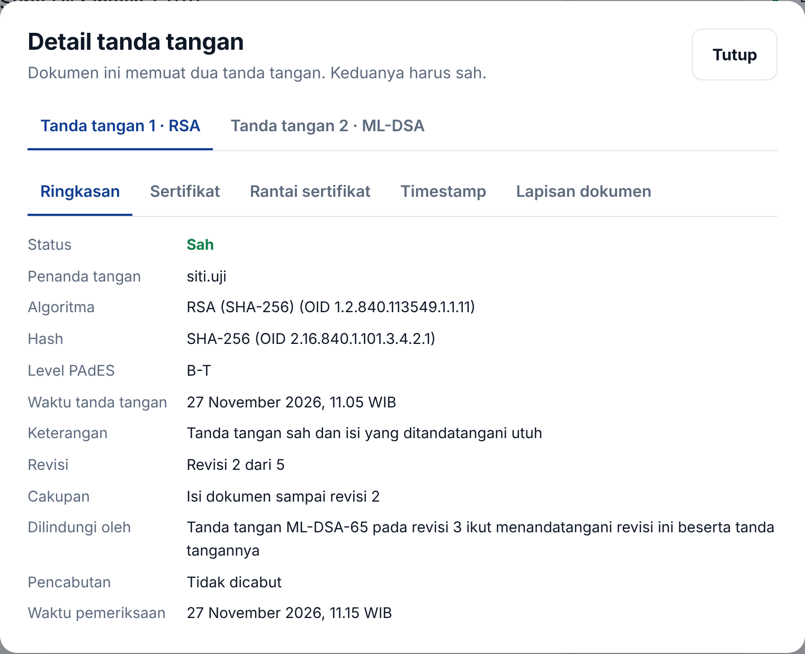
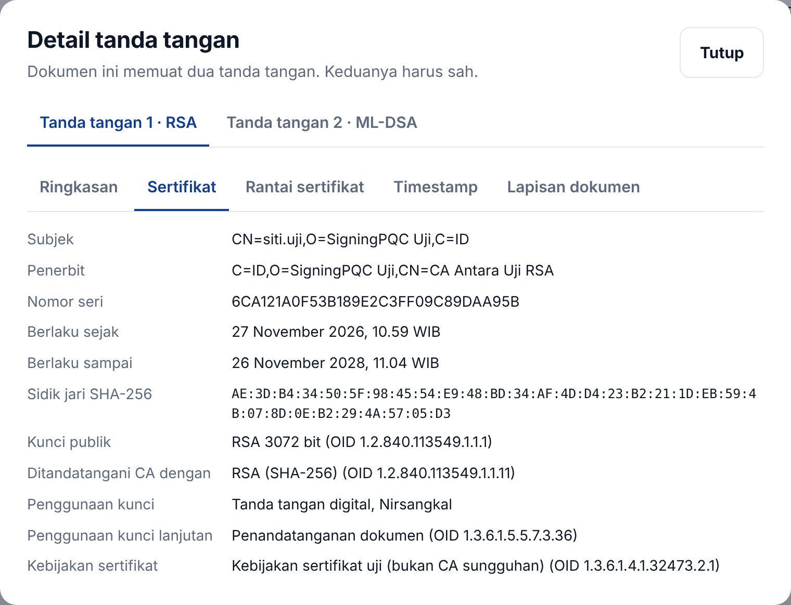
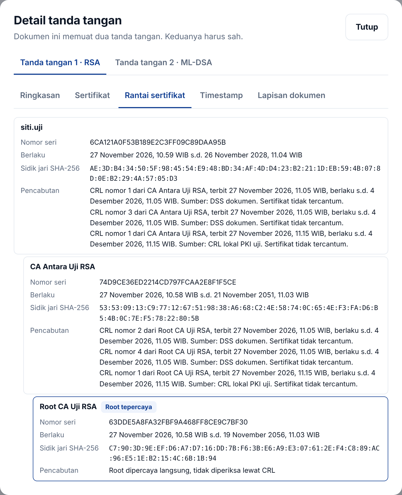
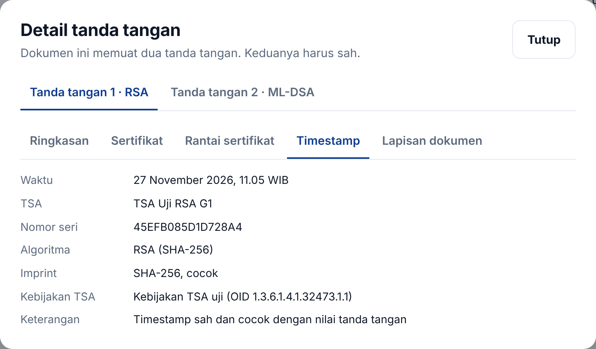
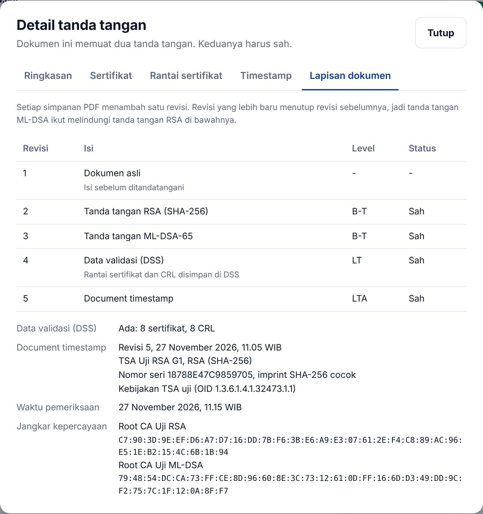
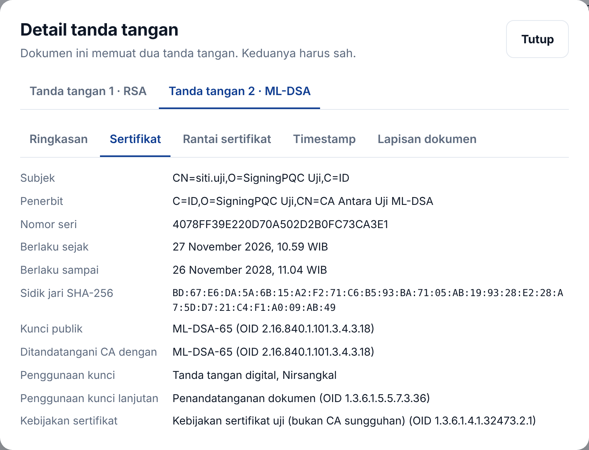

# T-019: Bukti pada detail verifikasi dan OID

| Butir | Isi |
|---|---|
| Tanggal | 27 Nov 2026 |
| Jenis | Temuan (kelengkapan bukti) dan perbaikan |
| Sprint | 3 (aplikasi pengguna) |
| Sumber temuan | Pertanyaan pengguna: apakah detail sertifikat di layar verifikasi sudah cukup untuk membuktikan penandatanganan, dan apakah OID perlu ditampilkan |
| Kebutuhan terkait | KF-21, KF-22, KF-23, KF-24 (ekspor laporan KF-25 tetap di Sprint 5) |
| Acuan | ETSI EN 319 102-1 (laporan validasi), ETSI EN 319 142-1 (PAdES), RFC 5280 (sertifikat dan CRL), RFC 3161 (timestamp), RFC 5612 (arc contoh 32473) |
| Lingkungan | Container Linux, OpenJDK 21 (`--release 21`), Spring Boot, Vitest, Playwright Chromium |
| Keputusan | Dipilih pengguna: "Poin a–g sekarang" |
| Status | Diperbaiki, uji lolos |

## Ringkasan
Dialog "Detail tanda tangan" sebelumnya menampilkan status, penanda tangan, algoritma, waktu, subjek dan penerbit sertifikat, nomor seri, masa berlaku, kunci, penggunaan kunci, nama-nama di rantai, dan timestamp tanda tangan. Itu cukup untuk pengguna biasa, tetapi belum cukup sebagai bukti yang bisa diperiksa ulang pihak lain. Sidik jari sertifikat, CRL yang dipakai, jangkar kepercayaan, waktu pemeriksaan, revisi yang ditutup tiap tanda tangan, dan OID algoritma belum terlihat.

OID perlu ditampilkan karena nama seperti "RSA (SHA-256)" atau "ML-DSA-65" adalah terjemahan aplikasi. Yang benar-benar tertulis di dokumen dan sertifikat adalah OID-nya. Pemeriksa lain (Adobe, DSS EU, OpenSSL) bisa mencocokkan OID secara langsung tanpa bergantung pada nama dari aplikasi ini.

## Poin bukti yang ditambahkan
| Poin | Isi | Letak di dialog |
|---|---|---|
| a | Algoritma hash dan level PAdES tiap tanda tangan, beserta OID algoritma tanda tangan dan hash dari SignerInfo | Ringkasan |
| b | Sidik jari SHA-256 sertifikat penanda tangan, kunci publik, algoritma tanda tangan CA, penggunaan kunci lanjutan (EKU), kebijakan sertifikat, semuanya dengan OID | Sertifikat |
| c | CRL yang tersedia untuk tiap sertifikat: penerbit, nomor CRL, waktu terbit, berlaku sampai, sumber (DSS dokumen atau CRL lokal PKI uji), dan apakah sertifikat tercantum | Rantai sertifikat |
| d | Waktu pemeriksaan dan jangkar kepercayaan yang dipakai (nama dan sidik jari SHA-256 root) | Ringkasan, Lapisan dokumen |
| e | Rincian tiap sertifikat di rantai: nomor seri, masa berlaku, sidik jari, status CRL. Root ditandai "dipercaya langsung, tidak diperiksa lewat CRL" | Rantai sertifikat |
| f | Revisi yang ditutup tiap tanda tangan ("Revisi 2 dari 5") dan pernyataan bahwa tanda tangan ML-DSA pada revisi 3 ikut menandatangani revisi RSA beserta tanda tangannya | Ringkasan |
| g | Tab baru "Lapisan dokumen": tabel revisi 1 sampai 5 (dokumen asli, RSA, ML-DSA, DSS, document timestamp) dengan level dan status, isi DSS (jumlah sertifikat dan CRL), serta rincian document timestamp (waktu, TSA, nomor seri, imprint, kebijakan TSA) | Lapisan dokumen |

## OID yang ditampilkan
| Butir | Contoh nilai pada dokumen uji | OID |
|---|---|---|
| Algoritma tanda tangan RSA | RSA (SHA-256) | 1.2.840.113549.1.1.11 |
| Algoritma tanda tangan ML-DSA | ML-DSA-65 | 2.16.840.1.101.3.4.3.18 |
| Hash tanda tangan RSA | SHA-256 | 2.16.840.1.101.3.4.2.1 |
| Hash tanda tangan ML-DSA | SHA-512 | 2.16.840.1.101.3.4.2.3 |
| Kunci publik RSA | rsaEncryption | 1.2.840.113549.1.1.1 |
| Kunci publik ML-DSA | ML-DSA-65 | 2.16.840.1.101.3.4.3.18 |
| EKU sertifikat penanda tangan | Penandatanganan dokumen (documentSigning) | 1.3.6.1.5.5.7.3.36 |
| Kebijakan sertifikat penanda tangan | Kebijakan sertifikat uji (bukan CA sungguhan) | 1.3.6.1.4.1.32473.2.1 |
| Kebijakan TSA | Kebijakan TSA uji | 1.3.6.1.4.1.32473.1.1 |

OID kebijakan memakai arc 1.3.6.1.4.1.32473 yang dicadangkan IANA untuk contoh dan dokumentasi (RFC 5612). Arc ini sengaja dipilih agar tidak bisa dikira kebijakan CA sungguhan.

## Perubahan kode
- `pki-test` `TestPkiFactory`: sertifikat penanda tangan (RSA dan ML-DSA) kini memuat ekstensi `certificatePolicies` dengan OID uji `1.3.6.1.4.1.32473.2.1` (konstanta `TEST_CERTIFICATE_POLICY`). Ekstensi tidak kritis, jadi validasi PKIX tetap lolos.
- `signer-core` `TimestampReport`: field baru `policyOid` dari TSTInfo. Konstruktor lama dengan 8 argumen tetap ada. `AlgorithmNames` dibuat publik.
- `signer-core` `DocumentValidator`: lapisan document timestamp kini membawa laporan tokennya di `signatureTimestamp`, sehingga nomor seri, imprint, dan kebijakan TSA bisa ditampilkan.
- `app-server` `VerifyService`:
  - `CertificateDetail` ditambah `fingerprintSha256`, `publicKey`, `signatureAlgorithm`, `extendedKeyUsage`, dan `certificatePolicies` (nama + OID).
  - `ChainEntry` ditambah `serialHex`, `notBefore`, `notAfter`, `fingerprintSha256`, dan `crls`.
  - `SignatureDetail` ditambah `revision`, `signatureAlgorithmOid`, `digestAlgorithmOid`, dan `protectedBy`.
  - `VerifyResponse` ditambah `trustAnchors` dan `dss`.
  - Teks cakupan tanda tangan yang tidak menutup seluruh dokumen kini "Isi dokumen sampai revisi N", karena "Revisi N dari M" sudah tampil di baris Revisi.
- Frontend:
  - `src/lib/evidence.ts` (baru): `labelWithOid`, `tsaPolicy`, `crlLine`, `documentRows`.
  - `SignatureDetail.vue`: bagian baru dan tab "Lapisan dokumen". Baris tab tanda tangan disembunyikan di tab itu karena isinya berlaku untuk seluruh dokumen.
  - `style.css`: gaya tabel lapisan dan sidik jari.

## Hasil uji
| Uji | Sebelum perbaikan | Sesudah |
|---|---|---|
| `TestPkiTest.sertifikatPenandaTanganMemuatKebijakanSertifikatUji` | Gagal: "certificatePolicies harus ada" | Lolos |
| `AccountApiTest.verifikasiMemuatBuktiDanOid` (a sampai g, OID, kebijakan TSA pada signature timestamp dan document timestamp) | Gagal: field `signatureAlgorithmOid` tidak ada | Lolos |
| `AccountApiTest.verifikasiMemuatBuktiDanOid`, teks cakupan | Gagal: "Revisi 2 dari 5" | Lolos: "Isi dokumen sampai revisi 2" |
| `evidence.test.ts` (9 uji, termasuk keterangan lapisan yang sama dengan status tidak diulang) | Gagal: modul belum ada | Lolos |

Seluruh suite:
- Backend 149/149 lolos: signer-core 7, pki-test 73, app-server 69.
- Frontend 59/59 lolos (10 berkas). `vue-tsc -b` bersih dan `npm run build` berhasil.

## Uji di aplikasi yang berjalan
Uji dijalankan di container: backend dari JAR dengan folder data sementara, frontend Vite, dan Playwright Chromium. Langkahnya:
1. Membuat akun uji `siti.uji`.
2. Menandatangani PDF sintetis satu halaman ("Surat Uji Sintetis T-019") dengan konfirmasi TOTP.
3. Memverifikasi hasilnya lewat layar Verifikasi.
4. Membuka "Lihat detail".

Hasil: dokumen sah, lima revisi, DSS berisi 8 sertifikat dan 8 CRL.

| Tab | Gambar |
|---|---|
| Ringkasan (RSA) |  |
| Sertifikat (RSA) |  |
| Rantai sertifikat (RSA) |  |
| Timestamp (RSA) |  |
| Lapisan dokumen |  |
| Sertifikat (ML-DSA) |  |

## Catatan dan keterbatasan
1. **Akun lama di laptop belum memuat kebijakan sertifikat.** Sertifikat akun diterbitkan saat pendaftaran. Sertifikat yang terbit sebelum perubahan ini tidak punya `certificatePolicies`, jadi baris "Kebijakan sertifikat" pada dokumen yang ditandatangani akun lama tertulis "Tidak dicantumkan". Akun yang didaftarkan sesudah pembaruan langsung memuat OID uji, tanpa perlu reset PKI uji.
2. **Daftar CRL berisi semua CRL yang tersedia dari penerbit itu**, baik dari DSS dokumen maupun CRL lokal PKI uji. Validator memakai CRL yang berlaku pada waktu yang dibuktikan. Daftar ini adalah bahan untuk pemeriksaan ulang, bukan penanda CRL mana yang dipilih validator.
3. **Jangkar kepercayaan yang ditampilkan adalah root dari rantai tanda tangan.** Rantai TSA divalidasi juga, tetapi rinciannya tidak ditampilkan di daftar ini.
4. **Ekspor laporan verifikasi (KF-25) tetap di Sprint 5.** Semua data di dialog ini sudah ada di jawaban JSON `/api/me/verify`, jadi ekspor nanti tinggal memformatnya.
5. Data uji sepenuhnya sintetis. Tidak ada dokumen, sertifikat, atau data BSrE yang dipakai.
