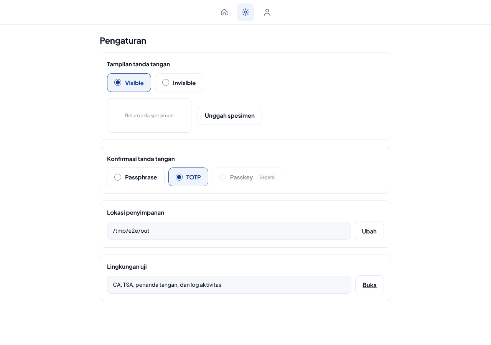
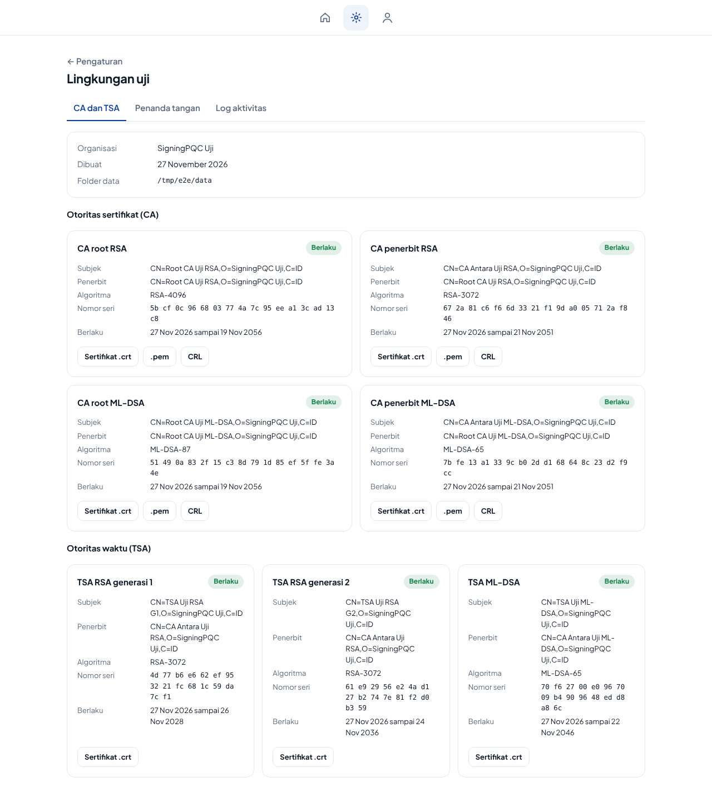
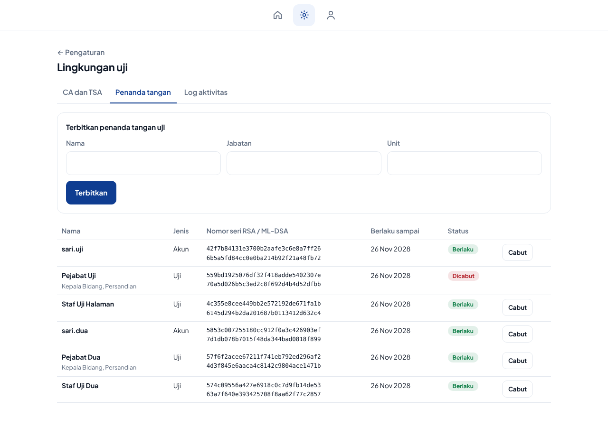
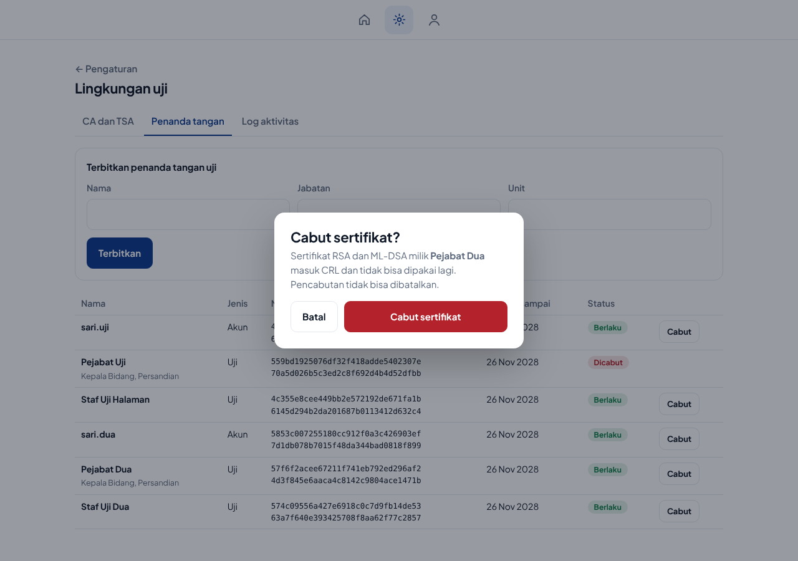
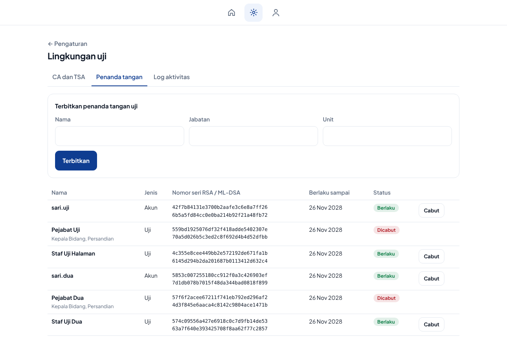
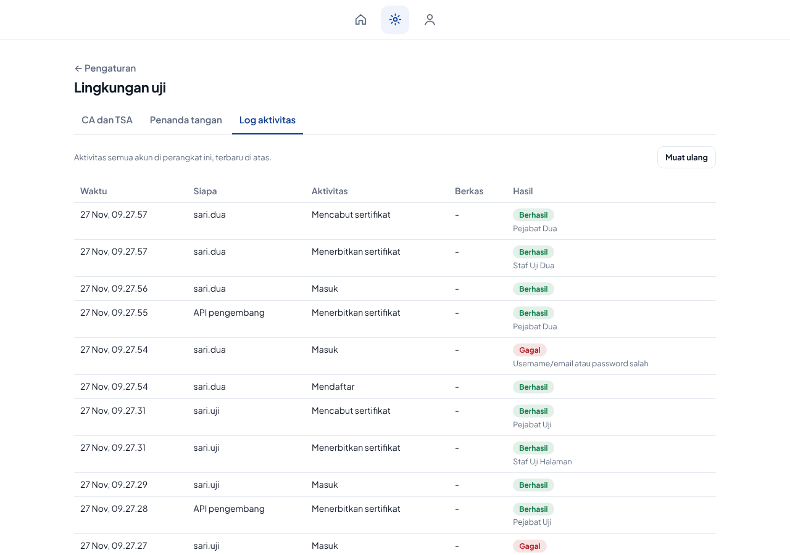
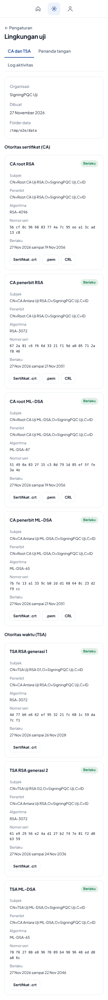

# T-020: Halaman Lingkungan uji (CA, TSA, penanda tangan) dan log aktivitas lokal

| Butir | Isi |
|---|---|
| Tanggal | 27 Nov 2026 |
| Jenis | Pengujian (fitur baru) |
| Sprint | 3 |
| Kebutuhan terkait | KF-34 (halaman pengelolaan CA, sertifikat, dan TSA uji), KF-35 (log aktivitas lokal: siapa, kapan, berkas apa, hasil) |
| Lingkungan | Container Linux, Temurin JDK 25.0.1, Maven 3, Node 22, Vite 8, Vitest 5, Google Chrome headless (puppeteer-core) |
| Commit dasar | `7a9aff3` (main setelah PR #1 dan #2) |
| Status | Lulus |

## Ringkasan
Pengaturan mendapat kotak keempat, **Lingkungan uji**, dengan tombol Buka ke halaman `#/lingkungan-uji`. Topbar tetap tiga ikon (anti-tujuan spesifikasi 26 Nov bagian 2), dan halaman ini tidak muncul di alur utama pengguna. Halaman berisi tiga tab:

| Tab | Isi |
|---|---|
| CA dan TSA | Organisasi, tanggal dibuat, folder data. Empat kartu CA (root dan penerbit untuk RSA dan ML-DSA) dan tiga kartu TSA (RSA generasi 1, RSA generasi 2, ML-DSA): subjek, penerbit, algoritma, nomor seri, masa berlaku, status (Berlaku / Belum berlaku / Kedaluwarsa). Tautan unduh sertifikat CA `.crt` dan `.pem`, CRL tiap CA, dan sertifikat TSA `.crt`. |
| Penanda tangan | Formulir "Terbitkan penanda tangan uji" (nama, jabatan, unit). Tabel semua penanda tangan: nama, jenis (Akun atau Uji), nomor seri RSA dan ML-DSA, berlaku sampai, status, dan tombol Cabut dengan dialog konfirmasi. Bila yang dicabut sertifikat akun sendiri, dialog memberi peringatan. |
| Log aktivitas | Tabel waktu, siapa, aktivitas, berkas, hasil (chip berwarna) dan keterangan, terbaru di atas, dengan tombol Muat ulang. |

## Log aktivitas (KF-35)
- Disimpan di `<data-dir>/activity.json`, satu berkas untuk seluruh perangkat (semua akun), maksimal 1.000 entri, API mengembalikan 200 terbaru. Berkas ditulis atomik seperti `history.json`.
- Tidak ikut terhapus saat PKI uji di-reset (reset sendiri tercatat sebagai "Mengatur ulang PKI uji").
- Dibaca lewat `GET /api/me/activity` (butuh sesi; tanpa token 401).
- Bentuk entri: `{time, actor, action, fileName, result, detail}`. `result` berisi `BERHASIL`, `GAGAL`, atau status verifikasi (`SAH`, `TIDAK_SAH`, `TIDAK_DAPAT_DIBUKTIKAN`, `TANPA_TANDA_TANGAN`).
- Pelaku: username akun. Panggilan REST tanpa sesi (skrip, Postman) tercatat sebagai "API pengembang". Gagal masuk dengan nama yang tidak terdaftar tercatat sebagai "(tidak dikenal)", jadi teks yang diketik pengguna tidak pernah disimpan.
- Tidak pernah memuat password, passphrase, kode TOTP, token, atau isi dokumen (diuji dengan mencari nilai-nilai itu di `activity.json`).
- Gagal menulis log hanya dicatat sebagai peringatan di log server, tidak menggagalkan tanda tangan yang sudah berhasil.

| Aktivitas | Endpoint | Berkas | Keterangan |
|---|---|---|---|
| Mendaftar | `POST /api/auth/register/finish` | - | - |
| Masuk (berhasil dan gagal) | `POST /api/auth/login` | - | Pesan galat, mis. "Username/email atau password salah" atau penguncian |
| Keluar | `POST /api/auth/logout` | - | - |
| Mengubah pengaturan | `PUT /api/me/settings` | - | Bagian yang diubah, mis. "Tampilan INVISIBLE" |
| Mengganti spesimen | `PUT /api/me/specimen` | nama gambar | - |
| Menandatangani | `POST /api/me/sign` | nama berkas asli | "Tersimpan sebagai surat-ttd.pdf" atau pesan galat, mis. "Konfirmasi tidak cocok" |
| Memverifikasi | `POST /api/me/verify` | nama berkas | Hasil berupa status verifikasi |
| Memperpanjang keabsahan | `POST /api/me/renew` | nama berkas | Nama berkas keluaran |
| Membuat / Mengatur ulang PKI uji | `POST /api/pki/setup` | - | Nama organisasi |
| Menerbitkan sertifikat | `POST /api/pki/signers` | - | Nama penanda tangan |
| Mencabut sertifikat | `POST /api/pki/signers/{id}/revoke` | - | Nama penanda tangan |

Endpoint pengembang `POST /api/sign` dan `POST /api/verify` sengaja tidak dicatat, sama seperti riwayat dokumen (spesifikasi 26 Nov bagian 6, tidak mengubah uji REST lama).

## Perubahan API pendukung (KF-34)
- `GET /api/pki` dan `GET /api/pki/signers`: setiap penanda tangan kini memuat `account` (true untuk sertifikat milik akun aplikasi) dan `createdAt`.
- Baru: `GET /api/pki/tsa/{id}.crt` (id `rsa-g1`, `rsa-g2`, `mldsa`) mengembalikan sertifikat TSA DER. TSA yang tidak dikenal 404.

## Langkah uji
1. Backend: `mvnw test` (di container `mvn -B test` dengan `JAVA_HOME` Temurin 25).
2. Frontend: `npm test` dan `npm run build` (termasuk `vue-tsc`).
3. Browser: backend jar dengan folder data baru di port 8085, `npx vite` di port 5173, lalu skrip puppeteer: daftar akun lewat API (TOTP dari otplib), satu kali gagal masuk, terbitkan "Pejabat Uji" lewat API tanpa token, masuk lewat formulir, buka Pengaturan, Lingkungan uji, periksa 15 tautan unduhan, terbitkan penanda tangan lewat formulir, cabut "Pejabat Uji" lewat dialog, buka Log aktivitas, ulangi di lebar 390 px.

## Hasil
| Uji | Jumlah | Gagal |
|---|---|---|
| `ActivityApiTest` (baru): daftar, masuk gagal/berhasil (termasuk nama tak dikenal), pengaturan, tanda tangan berhasil dan kode salah, verifikasi tanpa tanda tangan dan bukan PDF, terbit dan cabut dengan pelaku akun atau "API pengembang", keluar, tidak ada rahasia di berkas, status PKI dan sertifikat TSA ber-EKU timeStamping | 9 | 0 |
| Seluruh uji backend: signer-core 7, pki-test 73, app-server 78 | 158 | 0 |
| `lib/pki.test.ts` (baru): nama CA/TSA, alamat unduhan, masa berlaku, label hasil | 8 | 0 |
| Seluruh uji Vitest | 67 | 0 |
| Tautan unduhan di tab CA dan TSA (12 CA + 3 TSA) | 15 jawaban HTTP 200 | 0 |
| Galat JavaScript di konsol selama alur browser | 0 | - |

| Layar | Tangkapan |
|---|---|
| Pengaturan dengan kotak Lingkungan uji |  |
| CA dan TSA |  |
| Penanda tangan |  |
| Dialog cabut |  |
| Setelah dicabut |  |
| Log aktivitas |  |
| Lebar ponsel 390 px |  |

## Analisis
- Log per perangkat melengkapi riwayat per akun: riwayat menjawab "dokumen apa yang saya olah", log menjawab "siapa melakukan apa di perangkat ini", termasuk percobaan gagal yang tidak muncul di riwayat (kode salah, gagal masuk, pencabutan).
- Pencabutan lewat halaman ini langsung tercermin di Profil (status "Dicabut") dan menolak tanda tangan berikutnya, sesuai perilaku yang sudah ada (T-013).
- Halaman ini sengaja memakai istilah teknis (CA, TSA, CRL). Ia hanya untuk pengembang dan penguji, dan pengguna biasa tidak melewatinya.

## Keterbatasan dan tindak lanjut
- `/api/pki/**` tetap terbuka tanpa sesi seperti sebelumnya (dipakai skrip `coba-rest.ps1`). Halaman ini mengirim token bila ada, sehingga pelaku tercatat. Membatasi `/api/pki/**` hanya untuk sesi bisa dipertimbangkan sebelum Electron (Sprint 4).
- Tombol reset PKI tidak disediakan di halaman, karena menghapus semua akun. Reset tetap lewat `POST /api/pki/setup?reset=true`.
- Uji di browser Windows laptop menyusul bersama uji ulang seluruh alur (Sprint 3, TC-05).
